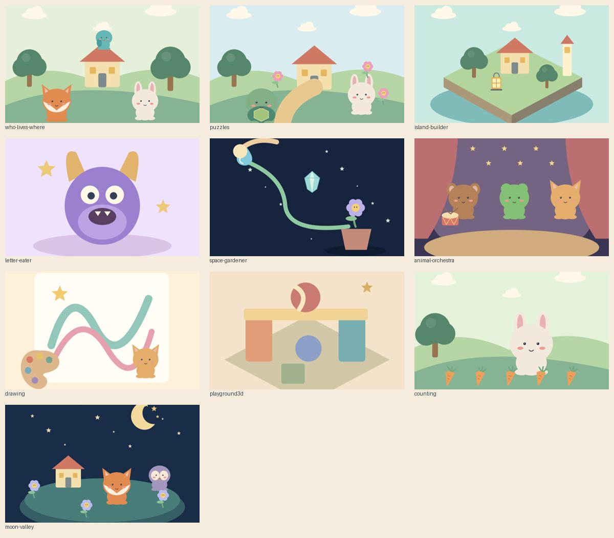
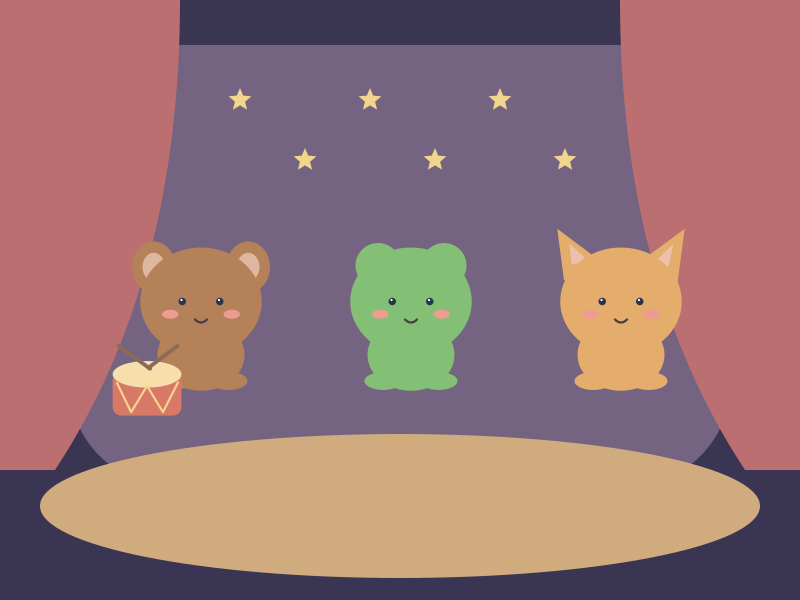
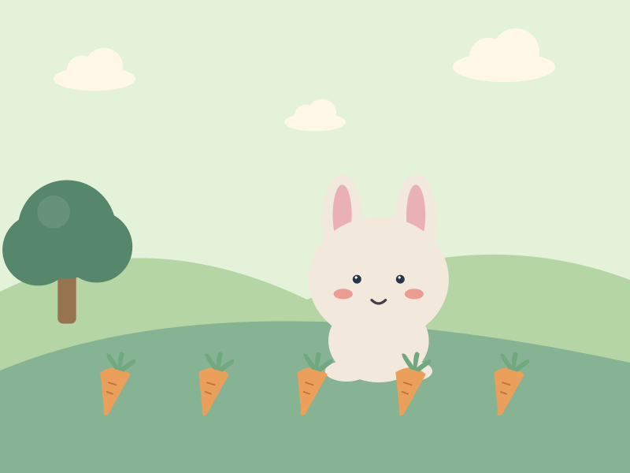
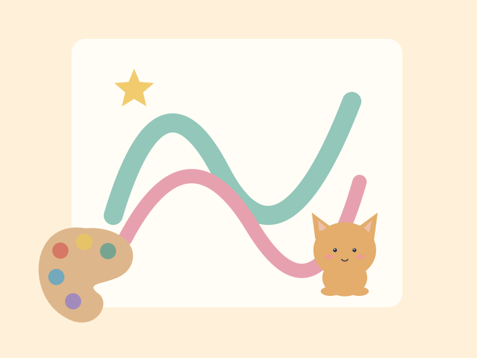
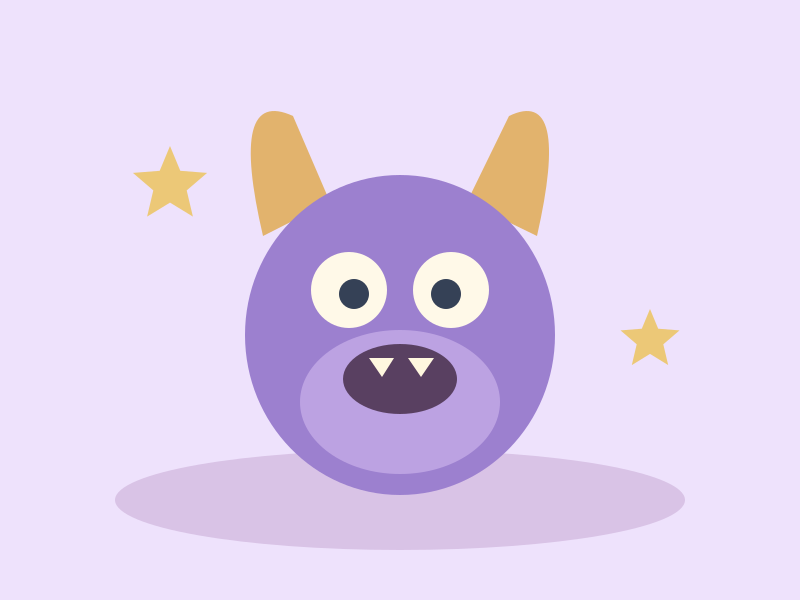
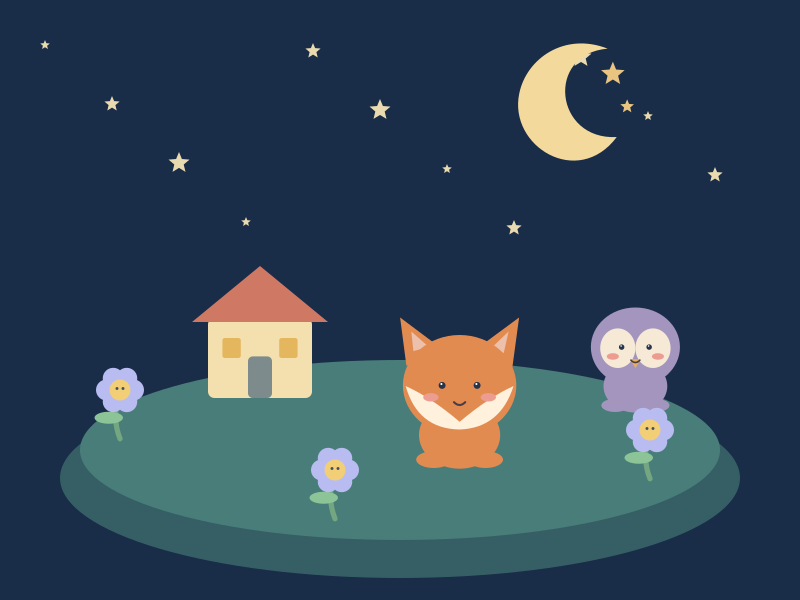
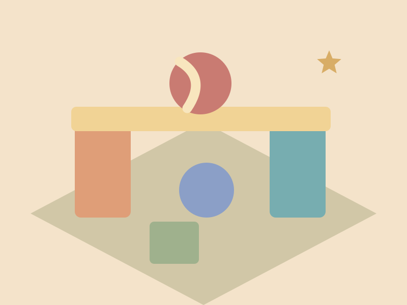
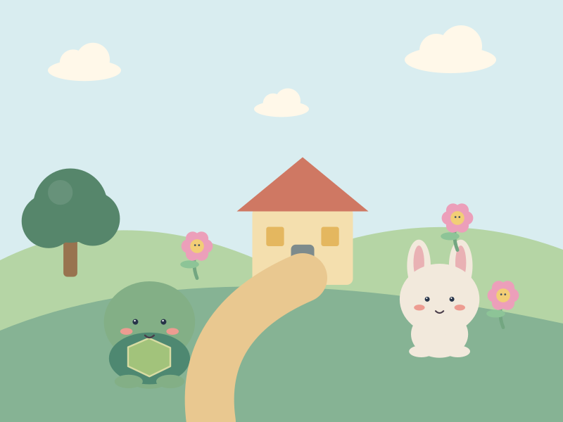
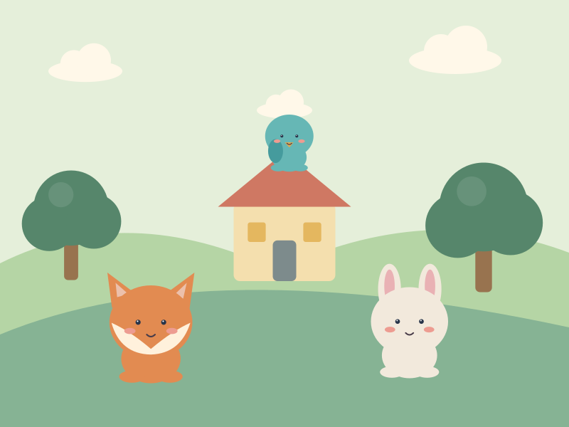

# Атлас маленьких миров · Visual Lab

## Новая визуальная серия · 2026

### Миры, обложки и раскраски v3

В [галерее](studio.html?category=habitats#vectors) обновлены **8 миров, 10 SVG-обложек и 6 раскрасок**. Одобренные персонажи, предметы и текстуры остаются v2. Предыдущие файлы сохранены; при открытии нового рисунка сравниваются версии v2 и v3.

Миры получили более естественные материалы, перспективу, свет и подробные природные сцены. SVG-обложки повторяют композиции одобренных PNG. Раскраски теперь занимают весь лист: фон заполнен листвой, домами, камнями, облаками и другими деталями. Это более сложные композиции для детей постарше и семейного раскрашивания.

Все 24 файла `*-v3.svg` содержат настоящие векторные контуры, без `<image>` и встроенного растра. Они получены трассировкой оригинальных сгенерированных иллюстраций: при сильном увеличении видны цветовые участки, а деревья и персонажи не выделены в отдельные смысловые слои. Цветные SVG существенно тяжелее v2; перед внедрением потребуется оптимизация под игровые экраны. Раскраски — контурные иллюстрации, не готовая карта интерактивных областей; работу заливки и замкнутость каждой области следует проверять при подключении к рисовалке.

Карточки используют лёгкие `*-v3-preview.jpg/png`, **отрисованные из готовых SVG**. В сравнении и по ссылке «Открыть SVG» загружается сам вектор. Исходные PNG новых сцен сохранены рядом как `*-source-v3.png`.

[manifest-vectors-v3.json](manifest-vectors-v3.json) описывает текущие 64 ресурса, [vector-jobs-v3.json](vector-jobs-v3.json) — 24 преобразования и промпты новых сцен. Повторная сборка: `python visual-lab/vectorize-v3.py visual-lab/vector-jobs-v3.json`; превью: `node visual-lab/render-v3-previews.mjs` (локальный Playwright и Edge). Зависимости трассировки указаны в скрипте, в приложение не добавлены.

При проработке раскрасок изучены композиции [Crayola — Summer Garden](https://www.crayola.com/es-mx/free-coloring-pages/print/summer-garden-coloring-page) и [Super Coloring — Mountain Forest](https://www.supercoloring.com/media/coloring/2571151/mountain-forest): заполненный сценой лист, читаемые контуры и разный размер деталей. Новые рисунки созданы самостоятельно. Векторизация: [VTracer](https://github.com/visioncortex/vtracer).

### Векторная коллекция v2

В [studio.html](studio.html#vectors) добавлен раздел **«Персонажи и SVG»**: 20 файлов персонажей (14 согласованных героев), 16 предметов, 8 сред обитания, 6 контурных раскрасок, 4 текстуры и 10 SVG-обложек. Все 64 исходных SVG имеют новую соседнюю версию `*-v2.svg`; оригиналы и одобренные PNG-обложки сохранены.

Это настоящие SVG с контурами, градиентами и стандартными SVG-фильтрами, без `<image>`, растровых вставок или внешних ресурсов. Персонажи и предметы имеют прозрачный фон; раскраски — белый. Векторный стиль передаёт объём светотенью и остаётся более стилизованным, чем PNG-иллюстрации.

[manifest-vectors-v2.json](manifest-vectors-v2.json) содержит полный список, размеры и соответствия исходникам. Галерея использует `vectors-data.js`, поэтому работает с диска без fetch и сервера. Для обновления списка нужно синхронно обновить JSON и JS. Повторяющиеся персонажи и предметы намеренно одинаковы между играми.

Для интеграции используйте ресурсы через `` или загрузчик игры. При вставке нескольких SVG непосредственно в один DOM нужно изолировать или префиксовать внутренние ID градиентов и фильтров. Текстуры пока являются образцами: бесшовность всех материалов отдельно не подтверждалась. Анимационные состояния персонажей не входят в эту серию.

Откройте **[studio.html](studio.html)** — новую галерею десяти миров с детализированными иллюстрациями, фильтрами и сравнением «до / после». Работает прямо с диска, без установки и сервера. Нажмите на обложку, затем передвигайте ползунок (доступен и с клавиатуры). Escape закрывает просмотр.

Новые обложки: `<game>/covers/cover-v2.png`, 1536 × 1024. Пути и точные промпты встроенного image_gen сохранены в [manifest-v2.json](manifest-v2.json). Старые SVG и исходная галерея сохранены. Новая серия — концепты и обложки; она не заменяет отдельные спрайты, раскраски или 3D-модели. Для Буквоеда печенье на обложке декоративное: обучающие буквы при интеграции нужно рисовать отдельно из данных игры.

Дизайн галереи: фон `#102b31`, поверхности `#19383e`, текст `#f4f3e9`, вторичный текст `#afc6c6`, акцент `#f0c583`, границы `#3b565a`. Основной шрифт Segoe UI, акцентный Georgia; внешние шрифты и библиотеки не загружаются.

Отдельная коллекция визуальных концептов для Interact Games. **Ничего не подключено к играм.** Изменения ограничены папкой `visual-lab/`.

## Как посмотреть

1. Скачайте репозиторий через **Code → Download ZIP** и распакуйте.
2. Откройте `visual-lab/index.html` в браузере. Установка зависимостей и сервер не нужны.
3. Картинки открываются в полном размере по нажатию. Ссылка в шапке ведёт к четырём живым Canvas-сценам.

GitHub показывает этот README и отдельные картинки, но не запускает HTML-галерею прямо на странице репозитория.

## Быстрый обзор SVG-обложек

## Что внутри

- 64 самостоятельных SVG: 10 обложек, 20 персонажей, 16 предметов, 8 сред обитания, 6 раскрасок, 4 текстуры.
- 4 сюжетных иллюстрации в WebP и их исходные PNG.
- 4 интерактивных Canvas-миниатюры в `demos/canvas-worlds.html`.
- `manifest.json` — пути, категории и названия ресурсов.

SVG нарисованы программно для этой коллекции. Сюжетные PNG созданы генератором изображений; WebP — оптимизированные копии. SVG-персонажи пока являются отдельными концептами, а не полными анимационными наборами. Текстуры — образцы материалов; бесшовность пока не гарантируется.

## Мировая карта

### [Звериный оркестр](animal-orchestra/)

**Лесной театр.** Деревянная сцена, музыкальные зверята и тёплые софиты.

### [Считай и играй](counting/)

**Маленькие открытия.** Счётные предметы с ясным силуэтом и три добрых проводника.

### [Рисовалка](drawing/)

**Мастерская воображения.** Чистый лист, волшебные инструменты и раскраски без мелких деталей.

### [Остров-конструктор](island-builder/)

**Бухта фонарей.** Маленький мир из кубиков: маяк, сад и вечерний причал.

### [Буквоед](letter-eater/)

**Печенья для монстрика.** Сиреневый обжора с добрыми глазами и буквенной кондитерской.

### [Лунная Долина](moon-valley/)

**Сад звёздного света.** Лисёнок, сова и зайчик берегут светящиеся растения.

### [3D-песочница](playground3d/)

**Лаборатория игрушек.** Деревянные дорожки, шары, арки и эксперименты с равновесием.

### [Пазлы](puzzles/)

**Истории по кусочкам.** Каждая картинка — маленькая история с узнаваемыми ориентирами.

### [Космический садовник](space-gardener/)

**Оранжерея среди комет.** Комета приносит воду по волшебным лианам к звёздному цветку.

### [Кто где живёт](who-lives-where/)

**Большой атлас домов.** Звери с характером и восемь отчётливо разных природных миров.

## Дальнейшее применение

После выбора направления: доработать формы и состояния персонажей, привести размеры и палитры к нужным игровым экранам, проверить на телефоне и только затем подключать через импорты. Для 3D-игр эти изображения служат обложками, UI и концептами; они не являются объёмными моделями.
