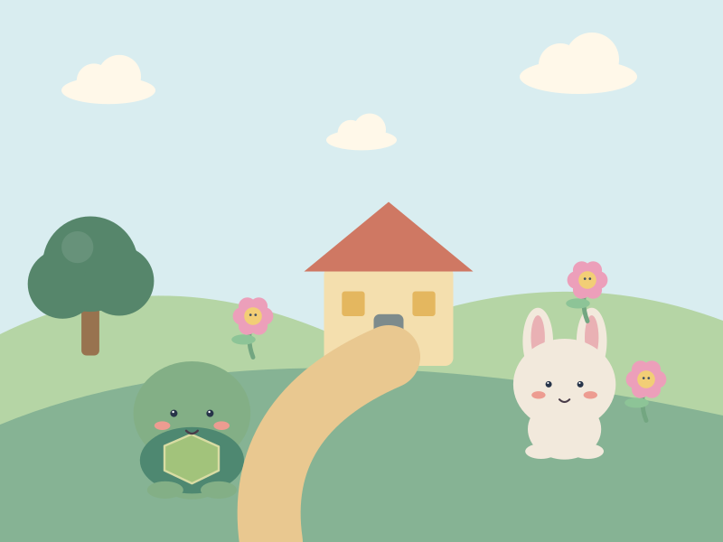
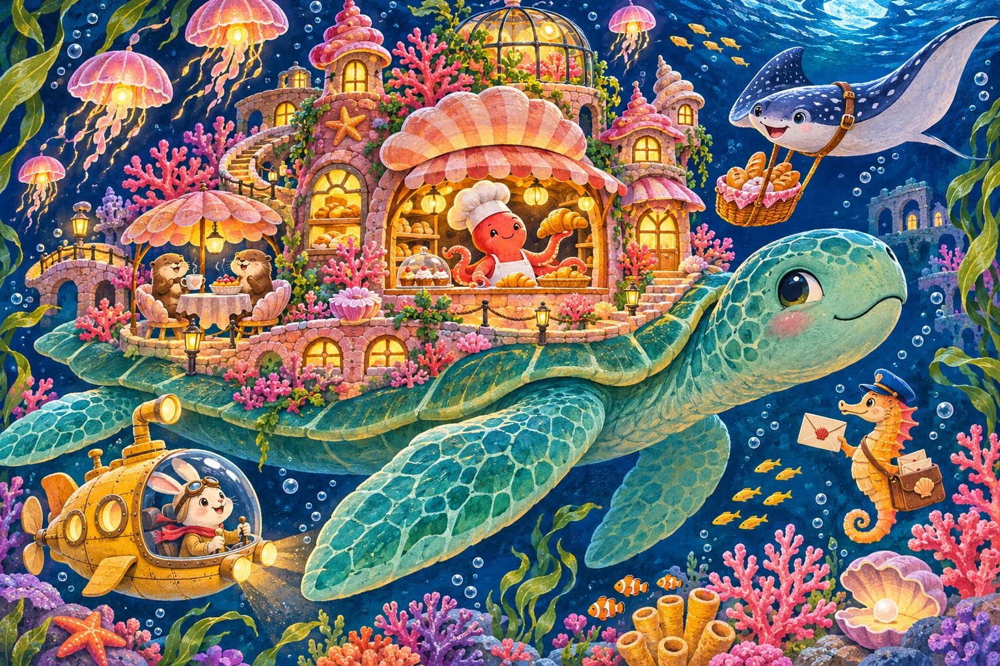

# Пазлы

## Истории по кусочкам

Каждая картинка — маленькая история с узнаваемыми ориентирами.

Концепт-ресурсы. Не подключены к игре. SVG созданы программно специально для этой коллекции; это самостоятельные векторные рисунки.

- [Пазлы — Истории по кусочкам](covers/cover.svg)

## Сюжетные иллюстрации

