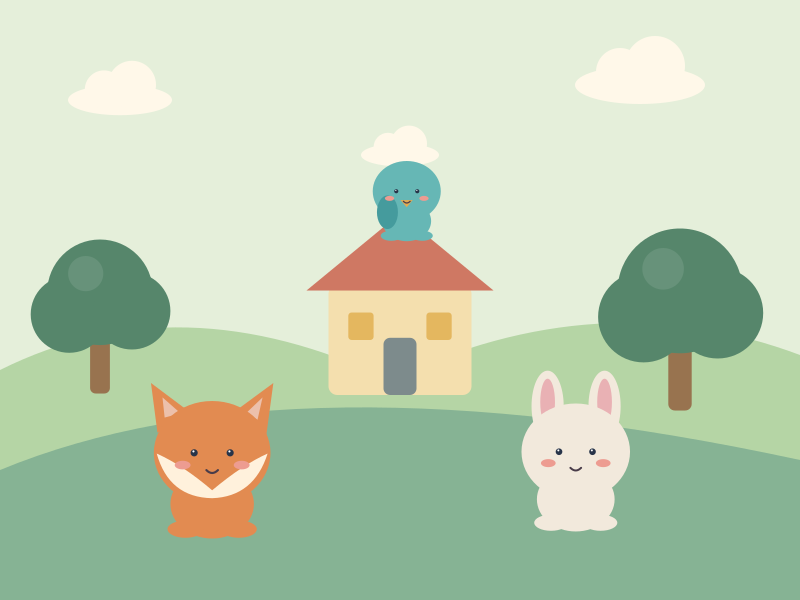

# Кто где живёт

## Большой атлас домов

Звери с характером и восемь отчётливо разных природных миров.

Концепт-ресурсы. Не подключены к игре. SVG созданы программно специально для этой коллекции; это самостоятельные векторные рисунки.

- [Кто где живёт — Большой атлас домов](covers/cover.svg)
- [fox · персонаж](characters/fox.svg)
- [bear · персонаж](characters/bear.svg)
- [cow · персонаж](characters/cow.svg)
- [frog · персонаж](characters/frog.svg)
- [penguin · персонаж](characters/penguin.svg)
- [turtle · персонаж](characters/turtle.svg)
- [bird · персонаж](characters/bird.svg)
- [Ферма](habitats/farm.svg)
- [Лес](habitats/forest.svg)
- [Море](habitats/sea.svg)
- [Дом](habitats/house.svg)
- [Пруд](habitats/pond.svg)
- [Джунгли](habitats/jungle.svg)
- [Саванна](habitats/savanna.svg)
- [Льды](habitats/ice.svg)

